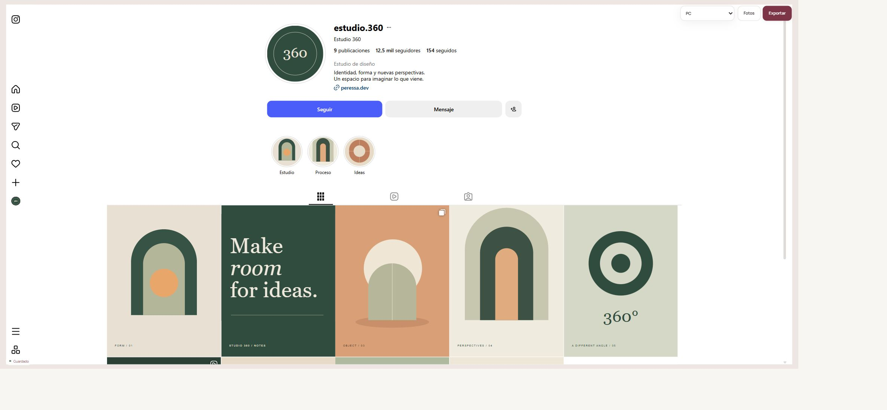
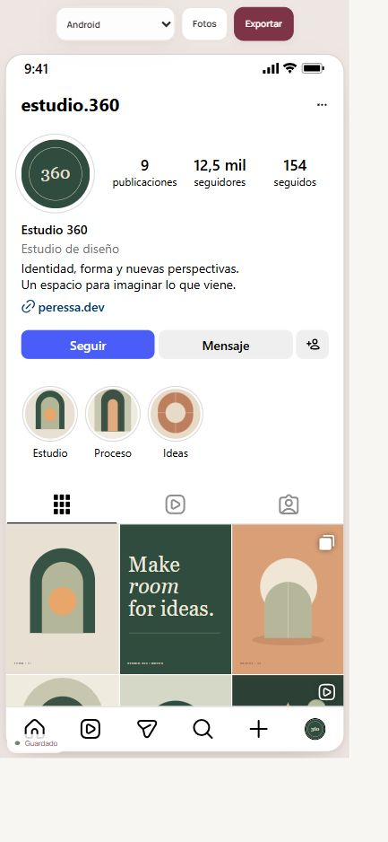
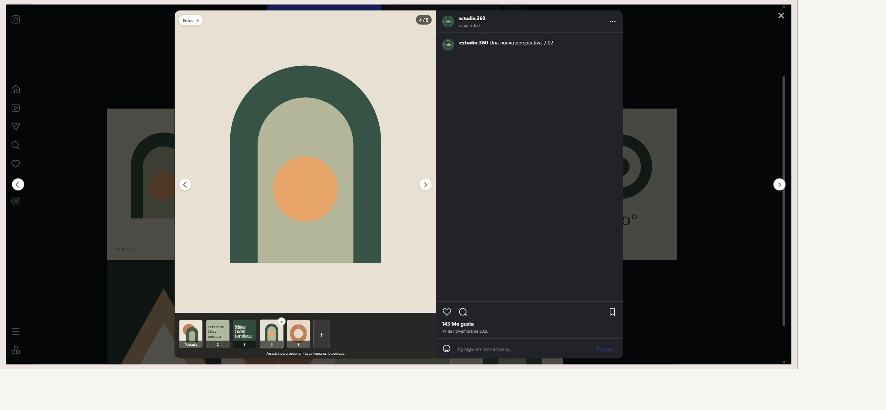
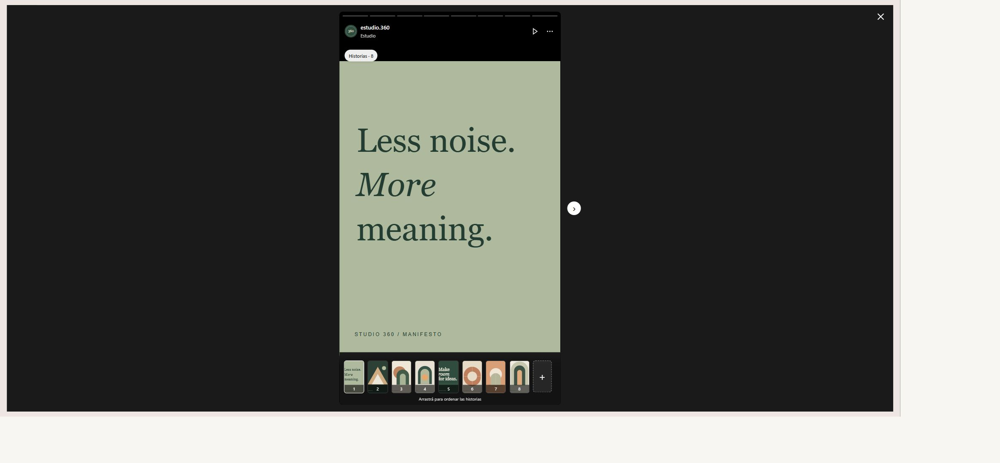

# Instagram 360

**Design the profile. Move the feed. Present the idea.**

An open source visual studio for designing and presenting Instagram profiles. Edit directly on the mockup, arrange your images and export your proposal. Created and maintained by [Juan Peressa](https://peressa.dev).

[Live demo](https://ig360.peressa.dev) · [Latest beta](https://github.com/peressa/instagram360/releases) · [Guía en español](docs/USAGE.md) · [Contribute](CONTRIBUTING.md)



## What you can do

- Start a project with a separate project name and Instagram display name, then use the contextual guide to discover editable areas.
- Edit names, biography and counts directly on the profile.
- Replace avatars/highlight covers and drag to crop inside their circles.
- Arrange a feed by dragging, preserving photos when resizing the grid.
- Create multi-photo carousels with the selection's Create carousel action, or by dragging a batch from the library. Arrange photos directly on the open post; browse with desktop arrows or native touch swipes.
- Preview mobile, desktop and tablet variants, light/dark and owner/visitor views.
- Drag library photos onto highlights; arrange and remove stories directly inside their viewer, with progress, pause/resume and navigation across highlights.
- Keep proposals locally, with JSON backup/import and recovery drafts.
- Create public editable links for any project and collaborate live without accounts.
- Export a profile PNG or a ZIP of prepared grid images.

No Instagram account connection or runtime API keys. Local projects stay in your browser until you explicitly share them. Public editable links use a Cloudflare Worker with Durable Objects and live WebSocket updates. The interface is Spanish.



<details>
<summary>Carousels and highlights in the current beta</summary>





</details>

## Run locally

Requires Node.js 22+. No dependencies to install or build step.

```sh
git clone https://github.com/peressa/instagram360.git
cd instagram360
node scripts/serve.cjs
```

Open **http://127.0.0.1:8765**. Run `node tests/run.cjs` (or `npm test`). Any static HTTPS host can serve `dist/`; see [hosting and architecture](docs/DEVELOPMENT.md).

## Try a complete example

Download [the example backup](examples/studio360.json) and import it from the profile's three-dot menu → **Proyecto y ajustes → Importar**. It creates a separate project with synthetic data and original graphics. See [usage and backups](docs/USAGE.md).

## Beta status

**v0.2.0-beta.4** improves biography/count extraction, supports available highlights and adds a free saved-HTML supplement. Public Instagram profile import starts at **Fotos → Importar Instagram**. Preview the available data and create a separate local editable copy, including available carousels. Public availability depends on Instagram; see [import limits](docs/INSTAGRAM-IMPORT.md). It also includes simplified profile exports and an Instagram dark-mode shortcut. It also supports editable project links such as `https://ig360.peressa.dev/p/my-project/`. Choose **Compartir**, pick an available address and create the link. Anyone with it can view and edit without an account. Profile, library, grid, carousels, highlights and submitted comments synchronize; comment drafts, simulated messages and preview preferences stay local. See [collaboration and deployment](docs/COLLABORATION.md).

Different fields merge automatically. Competing edits to the same field require an explicit choice; this is field-level collaboration, not character-level collaborative text. Pending edits survive disconnections in that browser. Keep JSON backups. Shared projects currently have no owner accounts, access revocation or public deletion UI.

Video playback and real Instagram publishing are not included. Device variants are presentation mockups, not certified replicas of every native app version. Android abbreviations and the exact 9999/10000 transition remain unverified; see [evidence and limits](references/counts/REVISION-ANDROID.md).

Local projects remain browser- and origin-specific. Static hosting and the downloadable static ZIP support the local editor; shared links require the Cloudflare backend. Earlier backups remain importable.

## Help shape the project

Read [CONTRIBUTING](CONTRIBUTING.md), [community conduct](CODE_OF_CONDUCT.md) and [security reporting](SECURITY.md). Bug reports, design feedback, accessibility fixes and well-sourced Instagram comparisons are welcome.

Next priorities: modularize remaining inline code; strengthen browser regression coverage; improve accessibility and add video playback. These are directions, not committed dates.

## Credits and license

Developed and maintained by **Juan Peressa**, building on [mkgrid](https://github.com/chrisvrakas/mkgrid) by **Chris Vrakas**, retaining the original MIT attribution. Licensed under [MIT](LICENSE), including the original example graphics. Bundled dependencies: html2canvas 1.4.1 ([MIT](dist/vendor/html2canvas.LICENSE.txt)) and Manrope ([SIL OFL](dist/fonts/OFL-Manrope.txt)).

Independent project, not affiliated with or endorsed by Instagram or Meta. Third-party brands and reference captures belong to their respective owners; MIT does not grant rights to those materials. Original example graphics and screenshots of this project's synthetic example are provided for reuse.
